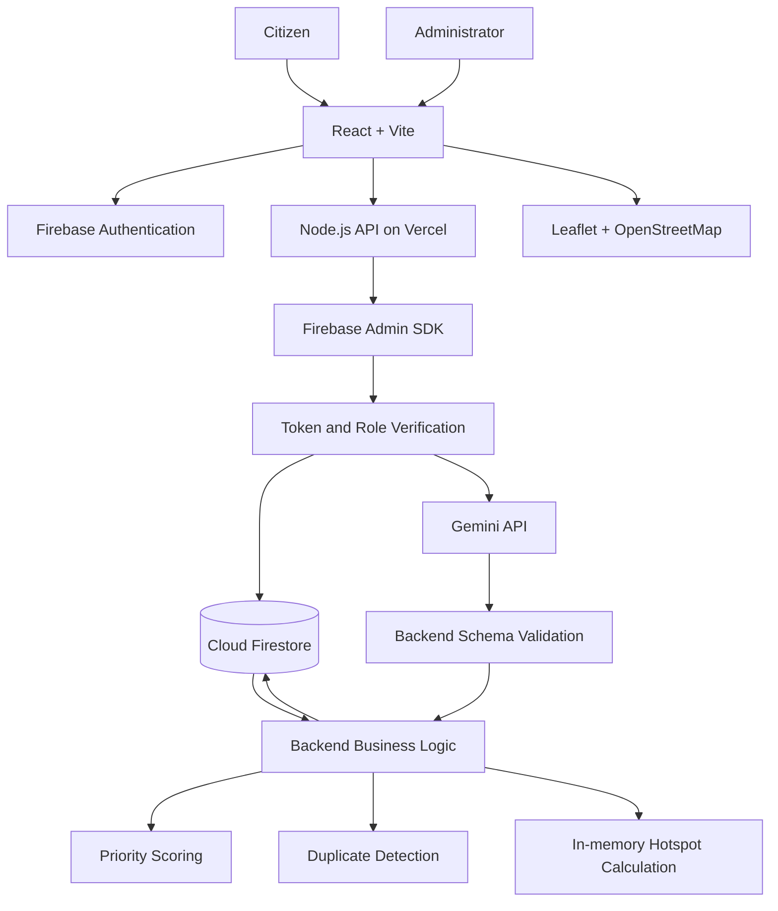

# CivicPulse — System Architecture

**Version:** 2.1
**Architecture:** Client-server with server-side Node.js API
**Deployment:** Local (ports 5173 + 5000) · Supabase free tier
**Status:** Implemented

---

## 1. Technology Stack

| Layer | Technology |
|---|---|
| Frontend | React + Vite |
| Styling | Tailwind CSS (CDN) |
| Backend | Node.js + Express |
| Authentication | Supabase Auth (email/password) |
| Database | Supabase PostgreSQL |
| Server authentication | Supabase JWT verification + service-role key |
| AI | Gemini Developer API (`gemini-1.5-flash`) |
| Maps | Leaflet + OpenStreetMap |
| Source control | GitHub |
| Deployment | Local dev (Vite port 5173, Express port 5000) |

No additional database, vector store, background worker, queue or paid hosting service is required.

## 2. System Architecture



## 3. Frontend Responsibilities

React handles:

- Registration and login interfaces.
- Firebase client authentication.
- Firebase ID token retrieval.
- Authenticated API requests.
- Complaint submission form.
- Map-based location selection.
- Complaint listing and details.
- AI-generated summary and category display.
- Priority explanation display.
- Citizen dashboard.
- Administrator dashboard.
- Complaint status display.
- Leaflet map and hotspot markers.
- Responsive layouts.

The frontend must never contain:
- Gemini API keys.
- Firebase Admin private keys.
- Trusted administrator credentials.
- Authoritative role decisions.
- Authoritative priority calculations.

Protected data changes must be handled by the backend.

## 4. Backend Responsibilities

The Node.js API handles:

1. Firebase ID token verification.
2. Administrator role verification.
3. Input validation.
4. Complaint creation and retrieval.
5. Gemini communication.
6. Gemini response validation.
7. Department mapping.
8. Priority calculation.
9. Duplicate candidate detection.
10. Complaint status updates.
11. Status history storage.
12. Hotspot calculation.
13. Dashboard aggregation.
14. Error handling and rate limiting.

The backend is the authority for permissions, complaint status, priority and data integrity.

## 5. Database Design

Use three Firestore collections.

### 5.1 users

Document ID: Firebase Authentication UID.

| Field | Type | Purpose |
|---|---|---|
| uid | string | Firebase UID |
| name | string | Display name |
| email | string | Registered email |
| createdAt | timestamp | Registration time |

Administrator role is held in Firebase custom claims, not assigned through the user's editable profile document.

The role claim is:

`{ "role": "admin" }`

A normal account has no administrator claim.

### 5.2 complaints

Document ID: Firestore-generated complaint ID.

| Field | Type | Purpose |
|---|---|---|
| title | string | Complaint title |
| description | string | Original complaint |
| summary | string | AI-generated summary |
| category | string | Confirmed category |
| aiSuggestedCategory | string | AI suggestion |
| keywords | array | AI-extracted keywords |
| department | string | Confirmed department |
| aiSuggestedDepartment | string | AI suggestion |
| priority | string | Low/Medium/High/Critical |
| priorityScore | number | Deterministic score |
| priorityReasons | array | Explanation |
| status | string | Current complaint status |
| citizenId | string | Owner UID |
| latitude | number | Location latitude |
| longitude | number | Location longitude |
| locationLabel | string | Display location |
| aiStatus | string | completed/unavailable/failed |
| aiModel | string | Model identifier |
| analysisVersion | string | Analysis version |
| createdAt | timestamp | Submission time |
| updatedAt | timestamp | Last update |
| statusHistory | array | Minimal status timeline |

`statusHistory` example structure:

- status
- note
- updatedBy
- timestamp

The initial history entry is `Submitted`.

Append a new entry whenever an administrator changes status. Keep the history bounded to the latest 20 entries for this prototype.

This replaces the separate `complaint_updates` collection.

Do not use this array as a general activity log.

### 5.3 duplicate_candidates

Document ID: Firestore-generated candidate ID.

| Field | Type | Purpose |
|---|---|---|
| complaintId | string | New complaint |
| candidateComplaintId | string | Possible existing duplicate |
| similarityScore | number | Heuristic score |
| distanceMeters | number | Geographic distance |
| reasons | array | Matching reasons |
| reviewed | boolean | Admin review state |
| createdAt | timestamp | Detection time |

Candidates are suggestions only. Original complaints remain separate.

### 5.4 No hotspot_summaries collection

Hotspots are calculated in memory from the complaints returned by the backend.

For the demo's 30–50 sample complaints, an additional collection is unnecessary.

Do not persist calculated hotspot results.

## 6. Complaint Categories

Allowed categories:

1. Roads and Potholes
2. Garbage and Waste Management
3. Water Supply
4. Drainage and Sewage
5. Streetlights and Electricity
6. Public Sanitation
7. Public Infrastructure
8. Other

Department mapping:

| Category | Department |
|---|---|
| Roads and Potholes | Public Works |
| Garbage and Waste Management | Sanitation |
| Water Supply | Water Supply |
| Drainage and Sewage | Drainage |
| Streetlights and Electricity | Electrical |
| Public Sanitation | Public Health |
| Public Infrastructure | Public Works |
| Other | General Municipal Administration |

These are demonstration mappings, not verified official municipal assignments.

## 7. API Endpoints

Base URL: `/api`

All protected endpoints require a valid Firebase ID token.

| Method | Endpoint | Access | Responsibility |
|---|---|---|---|
| GET | `/health` | Public | API health |
| GET | `/me` | Authenticated | Current user |
| POST | `/complaints` | Citizen | Submit complaint |
| GET | `/complaints/mine` | Citizen | Own complaints |
| GET | `/complaints` | Admin | All complaints |
| GET | `/complaints/:id` | Owner/Admin | Complaint details |
| PATCH | `/complaints/:id/status` | Admin | Change status and note |
| GET | `/complaints/:id/duplicates` | Owner/Admin | Candidate matches |
| GET | `/analytics/overview` | Admin | Dashboard statistics |
| GET | `/analytics/hotspots` | Admin | In-memory hotspots |

Do not create separate search or advanced filter endpoints in the MVP.

### API response format

Success:

```json
{
  "success": true,
  "data": {},
  "message": "Operation completed"
}
```

Failure:

```json
{
  "success": false,
  "error": {
    "code": "VALIDATION_ERROR",
    "message": "Invalid complaint data"
  }
}
```

Use suitable HTTP status codes:

- 200: Success.
- 201: Created.
- 400: Invalid request.
- 401: Authentication required.
- 403: Permission denied.
- 404: Resource not found.
- 409: Conflict.
- 429: Rate limit exceeded.
- 500: Internal error.
- 503: AI unavailable.

## 8. Authentication and Authorisation

### Authentication flow

1. Citizen registers using Supabase Auth (email/password).
2. Supabase creates the account and inserts a row into `public.users`.
3. User logs in.
4. Frontend obtains a Supabase JWT access token.
5. Frontend sends the token to Node.js via `Authorization: Bearer`.
6. Backend verifies the JWT using the Supabase service-role client.
7. Backend reads the authenticated UID and queries `public.users` for the role.
8. Backend checks the required role — never trusts role from the JWT payload.
9. Request is processed only when authorised.

Request header:

`Authorization: Bearer <Supabase_JWT_Access_Token>`

### Role rules

| Operation | Citizen | Admin |
|---|---|---|
| Submit complaint | Yes | Yes |
| View own complaints | Yes | Yes |
| View all complaints | No | Yes |
| Update complaint status | No | Yes |
| View admin analytics | No | Yes |
| View hotspots | Public map data only | Yes |

A citizen must not access another citizen's private complaint data.

Never accept `role: admin` from the frontend.

### Supabase Row Level Security

- Row Level Security (RLS) is enabled on `public.complaints` and `public.users`.
- Direct client writes to protected fields are denied by RLS policies.
- The backend uses the service-role key which bypasses RLS — backend authorisation middleware is therefore the primary security boundary.
- Citizens can only read their own complaints via `user_id = auth.uid()` RLS policy.
- All administrative mutations go through the server-side Express API only.

## 9. Exact Administrator Bootstrap Procedure

Administrator creation must be performed before evaluator testing.

Use a one-time local bootstrap script. Do not expose a public endpoint that lets users promote themselves.

### Step 1: Create the Supabase project

1. Open [supabase.com](https://supabase.com).
2. Create a new project on the free Spark tier.
3. Do not enable billing.
4. In the SQL Editor, run `backend/supabase/schema.sql` to create all tables and triggers.

### Step 2: Create the administrator account

1. Open `http://localhost:5173/register`.
2. Register using a designated administrator email.
3. Use a strong password.

The email and password are chosen by the project owner. No default credentials are assumed.

### Step 3: Configure the backend

1. Copy `backend/.env.example` to `backend/.env`.
2. Fill in `SUPABASE_URL`, `SUPABASE_ANON_KEY`, and `SUPABASE_SERVICE_ROLE_KEY` from Supabase Project Settings → API.
3. Fill in `GEMINI_API_KEY` from Google AI Studio.
4. Never commit `backend/.env` to GitHub.

### Step 4: Run the one-time role bootstrap

The bootstrap script is:

`scripts/set-admin-supabase.js`

Run from the project root:

```
node scripts/set-admin-supabase.js admin@example.com
```

It updates `role = 'admin'` in `public.users` for the specified email or UUID.
This script must be run manually by the project owner, not exposed as a public API.

### Step 5: Verify administrator access

1. Log out and log back in as the administrator account.
2. Request `GET /api/me`.
3. Confirm `isAdmin: true` in the response.
4. Access `GET /api/analytics/overview`.
5. Confirm the request returns HTTP 200.

### Step 6: Verify citizen isolation

1. Register a separate citizen account.
2. Log in.
3. Request an administrator endpoint.
4. Confirm the response is HTTP 403.

### Security rules

- No public admin registration.
- No frontend role selector.
- No role promotion through profile updates.
- Never include administrator credentials in GitHub.
- Never include service-account JSON in frontend assets.
- Never log service-account private keys.
- Keep the bootstrap utility restricted to local administrative use.

## 10. Gemini Configuration

Use the Gemini Developer API through the Node.js backend.

### Model — verification required before implementation

**Do not assume the model identifier below is correct for your account.**

Open Google AI Studio, select the intended project, and confirm the exact free-tier eligible model ID before writing any code. Update `GEMINI_MODEL` to match the verified identifier.

Placeholder identifier (replace after verification):

`<verify-model-id-in-ai-studio>`

Configuration:

| Setting | Proposed value |
|---|---|
| Model | `<verify-model-id-in-ai-studio>` — confirm in AI Studio |
| Temperature | 0.2 |
| Complaint title maximum | 120 characters |
| Complaint description maximum | 1,000 characters |
| Maximum output tokens | 512 |
| Response format | JSON |
| Candidate count | 1 |
| Request timeout | 12 seconds |
| AI calls per complaint | One initial analysis |

Before implementation:

1. Check the model in Google AI Studio.
2. Verify that it is available to the selected project.
3. Confirm that the model is available under the Free Tier.
4. Inspect the account's actual RPM, TPM and RPD limits.
5. Do not enable billing or upgrade the project.
6. If unavailable, choose a currently supported stable Flash model explicitly listed as free-tier eligible in that account.

Do not hardcode assumed request quotas. Gemini limits depend on the model, project and account tier. The actual active limits must be checked in AI Studio.

### Gemini API flow

1. Validate citizen request.
2. Store original complaint.
3. Check existing analysis state.
4. Send bounded input to Gemini.
5. Request structured JSON.
6. Parse and validate response.
7. Reject invalid output.
8. Calculate priority independently.
9. Save validated analysis.
10. Return complaint information.

## 11. Duplicate Detection

### Candidate retrieval limit

Retrieve a maximum of **100 most recent complaints** from the relevant recent time window.

For this prototype:

- Use a 30-day recent window.
- Retrieve up to 100 complaints, ordered by creation time.
- Do not retrieve the complete database.
- Perform geographic and text comparisons in memory.
- Consider all categories initially to avoid missing similar complaints classified differently.

The 100-record cap is a strict limit, not a pagination suggestion.

### Geographic distance

Calculate distance using the Haversine formula.

Initial duplicate test threshold:

**300 metres**

Candidates farther than 300 metres are excluded from the initial duplicate test.

### Candidate scoring

| Factor | Weight |
|---|---:|
| Same category | 30 |
| Geographic proximity | 30 |
| Keyword overlap | 20 |
| Description similarity | 20 |
| Total | 100 |

**Geographic proximity scoring note:** The 300-metre filter excludes distant complaints before scoring begins. All candidates that reach the scoring stage are already within 300 metres. To preserve meaningful score differentiation, apply a graduated sub-score within that range:

| Distance from new complaint | Proximity score |
|---|---:|
| 0–50 metres | 30 |
| 51–150 metres | 20 |
| 151–300 metres | 10 |

Interpretation:

- 80–100: Strong candidate.
- 60–79: Possible candidate.
- Below 60: Do not display as likely duplicate.

These are configurable heuristic weights, not statistical probabilities.

Never automatically merge or delete complaints.

## 12. Geographic Hotspots

Calculate hotspots in memory.

**Grid cell size:** `0.01 degrees` (approximately 1 km × 1 km at mid-latitudes).

This value is configurable. Store it as a named constant — do not scatter the raw number across the codebase. If the demonstration area is significantly larger or smaller, adjust accordingly and update the seeded test dataset to ensure the geographic cluster in §2.4 of the test plan falls within a single cell.

Processing:

1. Retrieve a bounded complaint dataset.
2. Exclude invalid coordinates.
3. Convert coordinates into fixed geographic grid cells.
4. Group complaints by cell.
5. Count complaints per cell.
6. Calculate the centre of each cell.
7. Return the results to the frontend.

Initial hotspot threshold:

Three or more complaints per cell.

The calculation is descriptive and does not prove actual infrastructure risk or statistically significant clustering.

No hotspot Firestore collection is required.

## 13. Environment Variables

### Frontend

```env
VITE_FIREBASE_API_KEY=
VITE_FIREBASE_AUTH_DOMAIN=
VITE_FIREBASE_PROJECT_ID=
VITE_FIREBASE_APP_ID=
VITE_API_BASE_URL=
```

### Backend

```env
NODE_ENV=development
PORT=5000

FIREBASE_PROJECT_ID=
FIREBASE_CLIENT_EMAIL=
FIREBASE_PRIVATE_KEY=

GEMINI_API_KEY=
GEMINI_MODEL=<verify-model-id-in-ai-studio>

ADMIN_SETUP_UID=
```

Additional test-only local variables:

```env
ENABLE_AI_FAILURE_TEST=false
AI_FAILURE_TEST_TOKEN=
```

These test variables must never be enabled in production.

### Environment security

- `VITE_` variables are public browser configuration.
- Gemini API key stays on the backend.
- Firebase Admin credentials stay on the backend.
- `.env` files must be ignored by Git.
- Never commit secrets.
- Use Vercel environment variables for deployment secrets.

## 14. Security Considerations

1. Verify every protected Firebase ID token.
2. Enforce administrator custom claims on the server.
3. Deny unauthorised Firestore client writes.
4. Validate every API request.
5. Restrict title length to 120 characters.
6. Restrict description length to 1,000 characters.
7. Validate latitude and longitude ranges.
8. Never trust client priority scores.
9. Never trust client-supplied roles.
10. Protect Gemini credentials.
11. Apply request rate limiting.
12. Prevent repeated Gemini calls.
13. Treat complaint text as untrusted input.
14. Validate AI output against a backend schema.
15. Do not allow AI output to trigger arbitrary database operations.
16. Keep citizen-private information out of public responses.
17. Use HTTPS in production.
18. Do not expose stack traces or secret values.
19. Keep the AI failure simulation unavailable in production.

Backend schema validation is the primary protection against invalid or malicious AI output. Prompt instructions are supplementary, not a security boundary.

## 15. Deployment Architecture

### Local deployment targets

- **Frontend:** Vite dev server at `http://localhost:5173`
- **Backend:** Express at `http://localhost:5000`
- **Database + Auth:** Supabase Spark free tier (cloud-hosted, no local setup required)
- **AI:** Gemini Developer API free tier (`gemini-1.5-flash`)
- **Maps:** OpenStreetMap public tile service (no API key required)

### Local run procedure

1. Apply `backend/supabase/schema.sql` in Supabase SQL Editor.
2. Populate `backend/.env` from `backend/.env.example`.
3. Populate `frontend/.env` from `frontend/.env.example`.
4. `cd backend && npm install && npm run dev` (port 5000).
5. `cd frontend && npm install && npm run dev` (port 5173).
6. Run `node scripts/set-admin-supabase.js <email>` to bootstrap admin.
7. Open `http://localhost:5173` and verify login.
8. Verify complaint submission, AI analysis, map, and admin dashboard.

### No-billing restrictions

- Do not enable Supabase paid tier.
- Do not link a billing account to any service.
- Do not enter payment details.
- Do not use Gemini paid-tier access.
- Do not use paid Google Cloud APIs.
- Verify current free-tier quotas before use.
- If a service requests billing activation, stop and use an eligible alternative or disable that optional integration.

This prototype is not a production municipal service.

### Process limitation

Do not depend on persistent WebSocket connections, background workers or long-running processes.

The Node.js API must complete each request independently.

---

**End of ARCHITECTURE.md**